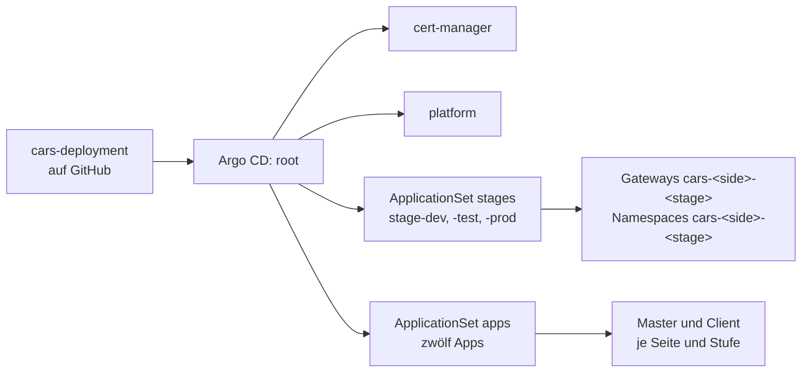

<!--
@license
Copyright (c) rljson

Use of this source code is governed by terms that can be
found in the LICENSE file in the root of this package.
-->

# cars-deployment

[English](README.md) | Deutsch

Was im Kubernetes-Cluster `aks-cars` der cars-Anwendung läuft, einer
Beispiel-App auf Rljson: Helm-Charts, eine Value-Datei je App und Stufe
und die Argo-CD-Anwendungen, die den Cluster mit diesem Repo
synchron halten.

## Motivation

- Was im Cluster läuft, ist in git beschrieben; eine Stufe ändert sich
  nur durch einen Commit hier
- Ein Argo CD bedient die Stufen `dev`, `test` und `prod`
- Die Azure-Ressourcen liegen in
  [cars-infra](https://github.com/rljson/cars-infra); eine Änderung an
  einem Image berührt sie nie

## Aufbau

| Pfad               | Inhalt                                                                              |
| ------------------ | ----------------------------------------------------------------------------------- |
| `charts/master`    | Helm-Chart eines Masters: der Node.js-Dienst einer Seite in einer Stufe             |
| `charts/client`    | Helm-Chart eines Clients: die statische Website, nginx leitet `/api/` zum Master    |
| `charts/stage`     | Helm-Chart einer Stufe: zwei Namespaces, Quoten, Netzwerkrichtlinien, das Gateway   |
| `values`           | `<side>-<service>-<stage>.yaml`, zwölf insgesamt: Seite, Dienst, Stufe, Image-Tag   |
| `stages`           | `dev.yaml`, `test.yaml`, `prod.yaml`                                                |
| `platform`         | Der Namespace `cars-gateway` und die Aussteller von Let's Encrypt                   |
| `argocd`           | Die Werte von Argo CD, die Root-Anwendung und `apps/`, das sie synchronisiert       |
| `bootstrap.js`     | Installiert Argo CD und übergibt ihm die Root-Anwendung                             |
| `promote.js`       | Kopiert die Image-Tags einer Stufe als Commit in die nächste                        |
| `set-password.js`  | Setzt das Passwort eines persönlichen Argo-CD-Kontos                                |
| `test.js`          | Prüft die Charts und rendert alle zwölf Apps und drei Stufen                        |



Jede Seite einer Stufe hat ein Gateway im Namespace `cars-gateway`,
dessen öffentliche IP den kostenlosen Azure-Namen
`cars-<side>-<stage>.germanywestcentral.cloudapp.azure.com` trägt, sechs
insgesamt. Der Client antwortet unter `/` seines Hosts, der Master unter
`/api` desselben Hosts:

| App           | URL in `dev`                                                        |
| ------------- | ------------------------------------------------------------------- |
| origin client | `https://cars-origin-dev.germanywestcentral.cloudapp.azure.com/`    |
| origin master | `https://cars-origin-dev.germanywestcentral.cloudapp.azure.com/api/hello` |
| custom client | `https://cars-custom-dev.germanywestcentral.cloudapp.azure.com/`    |
| custom master | `https://cars-custom-dev.germanywestcentral.cloudapp.azure.com/api/hello` |

http wird auf https umgeleitet. Ein Gateway nimmt nur die Routen seines
eigenen Namespaces an. Das Add-on betreibt zwei Pods je Gateway;
`gatewayResources` in `charts/stage/values.yaml` setzt ihre Anforderungen.
Die Pods einer Seite laufen auf ihrem Node Pool. Verkehr in einen Namespace
kommt nur aus demselben Namespace und von den Gateways; der origin
master nimmt zusätzlich den custom master derselben Stufe an.
cert-manager holt je Gateway ein Zertifikat von Let's Encrypt; `issuer`
in `charts/stage/values.yaml` wählt `letsencrypt`, dessen Zertifikaten
Browser vertrauen, oder `letsencrypt-staging`, um neue Namen unter
großzügigen Grenzen auszuprobieren.

## Verwendung

[Node.js](https://nodejs.org) 22 oder neuer, [Helm](https://helm.sh),
kubectl und kubelogin installieren, dann am Cluster anmelden:

```bash
az aks get-credentials --resource-group rg-cars --name aks-cars
kubelogin convert-kubeconfig -l azurecli
```

Argo CD einmal installieren; danach synchronisiert es alles aus git:

```bash
node bootstrap.js
```

Das Passwort des eigenen Kontos setzen; die Konten stehen in
`configs.cm` von `argocd/values.yaml`, der eingebaute Admin ist aus:

```bash
node set-password.js ben
```

Die Oberfläche von Argo CD unter <http://localhost:8080> öffnen und sich
damit anmelden:

```bash
kubectl -n argocd port-forward svc/argocd-server 8080:80
```

Ein Konto hinzufügen: es in `configs.cm` und `configs.rbac` von
`argocd/values.yaml` eintragen, `node bootstrap.js` ausführen, dann
`node set-password.js <account>`.

Eine App ändern: ihre Value-Datei bearbeiten, committen und pushen; Argo
CD synchronisiert sie. Eine Stufe in die nächste befördern, dann pushen
und einen Pull Request öffnen:

```bash
node promote.js dev test
node promote.js test prod
```

Argo CD folgt dem Branch, den `targetRevision` und `revision` jeder Datei
in `argocd` nennen; `test.js` prüft, dass sie übereinstimmen.

## Test

Vor jedem Commit:

```bash
node test.js
```

## Grenzen

- Keine CI: ein Betreiber baut die Images und ändert die Tags von Hand
- Die Oberfläche von Argo CD nur über Port-Forward, mit persönlichen
  Konten; die Anmeldung mit Entra folgt später
- Der Cluster stoppt jeden Abend; mit `az aks start` starten

## Stand

Argo CD läuft in `aks-cars` und hält alle achtzehn Anwendungen synchron:
cert-manager, platform, die drei Stufen und die zwölf Apps. Alle zwölf
URLs antworten über HTTPS mit Zertifikaten von Let's Encrypt.

## Lizenz

MIT — siehe [LICENSE](LICENSE).
