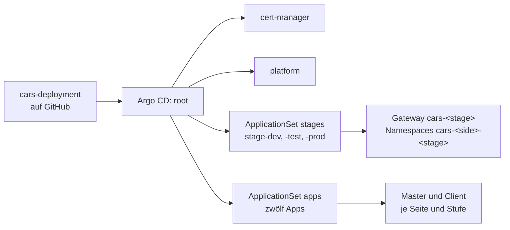

<!--
@license
Copyright (c) rljson

Use of this source code is governed by terms that can be
found in the LICENSE file in the root of this package.
-->

# cars-deployment

[English](README.md) | Deutsch

Was im Kubernetes-Cluster `aks-cars` der cars-Anwendung läuft, einer
Beispiel-App auf Rljson: Helm-Charts, eine Value-Datei je App und Stufe
und die Argo-CD-Anwendungen, die den Cluster mit diesem Repo
synchron halten.

## Motivation

- Was im Cluster läuft, ist in git beschrieben; eine Stufe ändert sich
  nur durch einen Commit hier
- Ein Argo CD bedient die Stufen `dev`, `test` und `prod`
- Die Azure-Ressourcen liegen in
  [cars-infra](https://github.com/rljson/cars-infra); eine Änderung an
  einem Image berührt sie nie

## Aufbau

| Pfad               | Inhalt                                                                              |
| ------------------ | ----------------------------------------------------------------------------------- |
| `charts/master`    | Helm-Chart eines Masters: der Node.js-Dienst einer Seite in einer Stufe             |
| `charts/client`    | Helm-Chart eines Clients: die statische Website, nginx leitet `/api/` zum Master    |
| `charts/stage`     | Helm-Chart einer Stufe: zwei Namespaces, Quoten, Netzwerkrichtlinien, das Gateway   |
| `values`           | `<side>-<service>-<stage>.yaml`, zwölf insgesamt: Seite, Dienst, Stufe, Image-Tag   |
| `stages`           | `dev.yaml`, `test.yaml`, `prod.yaml`                                                |
| `platform`         | Der Namespace `cars-gateway` und die Aussteller von Let's Encrypt                   |
| `argocd`           | Die Werte von Argo CD, die Root-Anwendung und `apps/`, das sie synchronisiert       |
| `bootstrap.js`     | Installiert Argo CD und übergibt ihm die Root-Anwendung                             |
| `promote.js`       | Kopiert die Image-Tags einer Stufe als Commit in die nächste                        |
| `test.js`          | Prüft die Charts und rendert alle zwölf Apps und drei Stufen                        |



Jede Stufe hat ein Gateway im Namespace `cars-gateway`, dessen
öffentliche IP den kostenlosen Azure-Namen
`cars-<stage>.germanywestcentral.cloudapp.azure.com` trägt. Jede App wird
über ihren Pfad erreicht, den das Gateway entfernt:

| App                     | URL in `dev`                                                          |
| ----------------------- | --------------------------------------------------------------------- |
| origin master           | `https://cars-dev.germanywestcentral.cloudapp.azure.com/origin-master/` |
| origin client           | `https://cars-dev.germanywestcentral.cloudapp.azure.com/origin-client/` |
| custom master           | `https://cars-dev.germanywestcentral.cloudapp.azure.com/custom-master/` |
| custom client           | `https://cars-dev.germanywestcentral.cloudapp.azure.com/custom-client/` |

Ein Pfad ohne Schrägstrich wird auf ihn umgeleitet, http auf https. Die
Pods einer Seite laufen auf ihrem Node Pool. Verkehr in einen Namespace
kommt nur aus demselben Namespace und von den Gateways; der origin
master nimmt zusätzlich den custom master derselben Stufe an.
cert-manager holt je Gateway ein Zertifikat von Let's Encrypt; `issuer`
in `charts/stage/values.yaml` wählt `letsencrypt-staging` oder
`letsencrypt`.

## Verwendung

[Node.js](https://nodejs.org) 22 oder neuer, [Helm](https://helm.sh),
kubectl und kubelogin installieren, dann am Cluster anmelden:

```bash
az aks get-credentials --resource-group rg-cars --name aks-cars
kubelogin convert-kubeconfig -l azurecli
```

Argo CD einmal installieren; danach synchronisiert es alles aus git:

```bash
node bootstrap.js
```

Die Oberfläche von Argo CD öffnen; das Skript zeigt den Befehl für das
Passwort:

```bash
kubectl -n argocd port-forward svc/argocd-server 8080:80
```

Eine App ändern: ihre Value-Datei bearbeiten, committen und pushen; Argo
CD synchronisiert sie. Eine Stufe in die nächste befördern, dann pushen
und einen Pull Request öffnen:

```bash
node promote.js dev test
node promote.js test prod
```

Argo CD folgt dem Branch, den `targetRevision` und `revision` jeder Datei
in `argocd` nennen; `test.js` prüft, dass sie übereinstimmen.

## Test

Vor jedem Commit:

```bash
node test.js
```

## Grenzen

- Keine CI: ein Betreiber baut die Images und ändert die Tags von Hand
- Die Oberfläche von Argo CD nur über Port-Forward, mit dem eingebauten
  Admin; die Anmeldung mit Entra folgt später
- Der Cluster stoppt jeden Abend; mit `az aks start` starten

## Stand

Charts, Werte und Argo-CD-Anwendungen sind geschrieben; Argo CD ist noch
nicht installiert.

## Lizenz

MIT — siehe [LICENSE](LICENSE).
