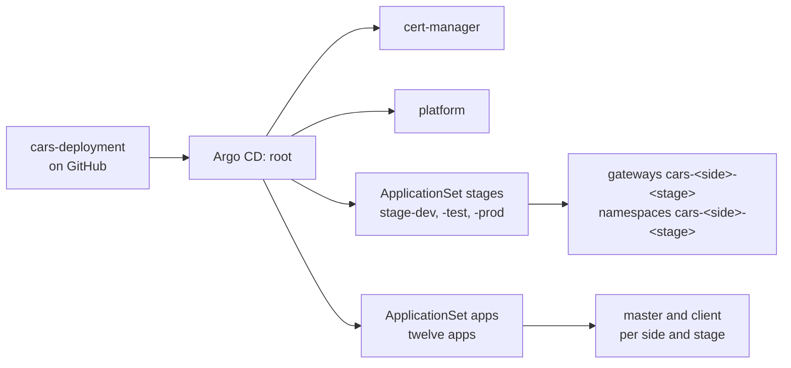

<!--
@license
Copyright (c) rljson

Use of this source code is governed by terms that can be
found in the LICENSE file in the root of this package.
-->

# cars-deployment

English | [Deutsch](README.de.md)

What runs in the Kubernetes cluster `aks-cars` of the cars application,
an example app built on Rljson: Helm charts, one values file per app and
stage, and the Argo CD applications that keep the cluster in sync with
this repo.

## Motivation

- What runs in the cluster is described in git; a stage changes only by
  a commit here
- One Argo CD serves the stages `dev`, `test` and `prod`
- The Azure resources live in
  [cars-infra](https://github.com/cars-world/cars-infra); a change to an image
  never touches them

## Layout

| Path               | Content                                                                          |
| ------------------ | -------------------------------------------------------------------------------- |
| `charts/master`    | Helm chart of a master: the Node.js service of one side in one stage; with `data.clientId`, the service account `master` with that workload identity and the variables `CARS_SQL_SERVER`, `CARS_SQL_DATABASE`, `CARS_BLOB_URL`, `CARS_BLOB_CONTAINER` |
| `charts/client`    | Helm chart of a client: the static website, nginx forwards `/api/` to the master |
| `charts/stage`     | Helm chart of a stage: two namespaces, quotas, network policies, the gateways    |
| `values`           | `<side>-<service>-<stage>.yaml`, twelve in all: side, service, stage, image tag  |
| `stages`           | `dev.yaml`, `test.yaml`, `prod.yaml`                                             |
| `platform`         | The namespace `cars-gateway` and the Let's Encrypt issuers                       |
| `argocd`           | The values of Argo CD, the root application and `apps/`, which it syncs          |
| `bootstrap.js`     | Installs Argo CD and hands it the root application                               |
| `promote.js`       | Copies the image tags of one stage into the next, as a commit                    |
| `set-password.js`  | Sets the password of a personal Argo CD account                                  |
| `set-tag.js`       | Sets the image tag of one app in one stage, without committing                   |
| `.github/workflows/build.yaml` | Reusable workflow: tests an app, builds its image into `crcars`, deploys it to `dev` |
| `.github/workflows/promote.yaml` | Promotes a stage to the next as a pull request, with a Trivy scan as the check `scan` |
| `.github/workflows/scan.yaml` | Reports the check `scan` on every pull request; scans when `test` or `prod` change |
| `scan-images.sh`   | Scans images of `crcars` with Trivy; used by `promote` and `scan`                |
| `.github/rulesets/main.json` | The rule on `main`: pull requests, the check `scan`, a code owner review for `prod` |
| `.github/CODEOWNERS` | The reviewer of `values/*-prod.yaml`                                            |
| `images.js`        | Lists the images of the four apps of a stage                                     |
| `test.js`          | Lints the charts and renders all twelve apps and three stages                    |



Each side of a stage has a gateway in the namespace `cars-gateway` whose
public IP carries the free Azure name
`cars-<side>-<stage>.germanywestcentral.cloudapp.azure.com`, six in all.
The client answers at `/` of its host, the master under `/api` of the
same host:

| App           | URL in `dev`                                                        |
| ------------- | ------------------------------------------------------------------- |
| origin client | `https://cars-origin-dev.germanywestcentral.cloudapp.azure.com/`    |
| origin master | `https://cars-origin-dev.germanywestcentral.cloudapp.azure.com/api/hello` |
| custom client | `https://cars-custom-dev.germanywestcentral.cloudapp.azure.com/`    |
| custom master | `https://cars-custom-dev.germanywestcentral.cloudapp.azure.com/api/hello` |

http is redirected to https. A gateway accepts the routes of its own
namespace only. The add-on runs two pods per gateway;
`gatewayResources` in `charts/stage/values.yaml` sets their requests. The
pods of a side run on its node pool. Traffic into a namespace comes only from the
same namespace and the gateways; the origin master also accepts the
custom master of the same stage. cert-manager gets a certificate per
gateway from Let's Encrypt; `issuer` in `charts/stage/values.yaml`
selects `letsencrypt`, whose certificates browsers trust, or
`letsencrypt-staging` for trying out new names under generous limits.

## Usage

Install [Node.js](https://nodejs.org) 22 or later,
[Helm](https://helm.sh), kubectl and kubelogin, then sign in to the
cluster:

```bash
az aks get-credentials --resource-group rg-cars --name aks-cars
kubelogin convert-kubeconfig -l azurecli
```

Install Argo CD once; it then syncs everything from git:

```bash
node bootstrap.js
```

Set the password of your personal account; the accounts are listed in
`configs.cm` of `argocd/values.yaml`, the built-in admin is off:

```bash
node set-password.js ben
```

Open the UI of Argo CD at <http://localhost:8080> and sign in with it:

```bash
kubectl -n argocd port-forward svc/argocd-server 8080:80
```

Add an account: list it in `configs.cm` and `configs.rbac` of
`argocd/values.yaml`, run `node bootstrap.js`, then
`node set-password.js <account>`.

Change an app: edit its values file and open a pull request; Argo CD syncs
it after the merge.

Promote a stage to the next in the tab **Actions → Promote → Run
workflow**, with `dev` or `test`. The workflow commits the promotion on a
branch, scans the images the next stage will run with Trivy, reports the
result as the check `scan` and opens the pull request. A finding of
severity high or critical that has a fix fails the check. `test` merges
without a review, `prod` needs the review of its code owner. The same by
hand, then push the branch and open a pull request:

```bash
node promote.js dev test
node promote.js test prod
```

Every other pull request gets the check `scan` from the workflow `scan`:
it passes at once unless the pull request changes the values of `test`
or `prod`, whose images it then scans. With **Allow auto-merge** on, a
pull request merges by itself once `scan` passes and, for `prod`, its
code owner approved.

The rule on `main` lives in `.github/rulesets/main.json`: changes go
through pull requests with a passing `scan`; the GitHub App `cars-deploy`
and the owners of the organization may bypass it. Apply it once, and again
after a change:

```bash
gh api -X POST repos/cars-world/cars-deployment/rulesets --input .github/rulesets/main.json
```

Deploy an app to `dev` from its own repo: on a push to `main` it calls the
reusable workflow `build`, which tests the app, builds the image
`crcars.azurecr.io/cars-<app>:<version>-<short commit>`, writes the tag
into `values/<app>-dev.yaml` with `set-tag.js` and pushes it to `main`.
It signs in to Azure through OIDC and writes here with a token of the
GitHub App `cars-deploy`, whose key lies in `kv-cars-github`; no secret is
stored in GitHub. The caller needs the variables `AZURE_CLIENT_ID`,
`AZURE_TENANT_ID`, `AZURE_SUBSCRIPTION_ID` and `CARS_DEPLOY_APP_ID`:

```yaml
on:
  push:
    branches: ['main']
permissions:
  id-token: write
  contents: read
jobs:
  deploy:
    uses: cars-world/cars-deployment/.github/workflows/build.yaml@main
    with:
      app: origin-master
```

Set a tag by hand:

```bash
node set-tag.js origin-master dev 0.1.0-ab12cd3
```

Argo CD follows `main`, named in `targetRevision` and `revision` of
every file in `argocd`; `test.js` checks they agree. A merge into `main`
deploys; Argo CD deletes what disappears from `main`.

## Test

Before each commit:

```bash
node test.js
```

## Limitations

- Only the images are scanned, not the charts
- `.trivyignore` accepts listed findings until their date `exp`, each
  with its reason; today the nginx findings of the clients until
  2026-12-03
- The UI of Argo CD only through port-forward, with personal accounts;
  sign-in with Entra comes later
- The cluster stops every evening; start it with `az aks start`

## Status

Argo CD runs in `aks-cars` and keeps all eighteen applications synced:
cert-manager, platform, the three stages and the twelve apps. All twelve
URLs answer over HTTPS with certificates of Let's Encrypt.

## License

MIT — see [LICENSE](LICENSE).
