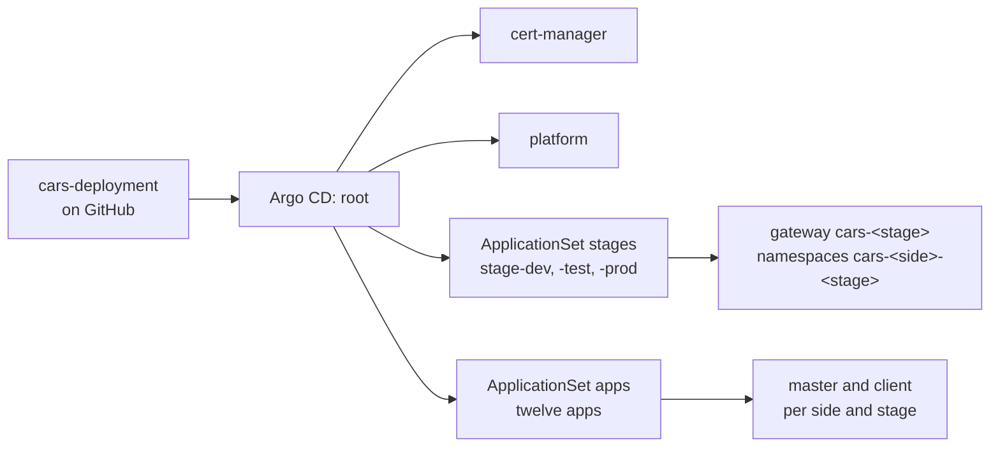

<!--
@license
Copyright (c) rljson

Use of this source code is governed by terms that can be
found in the LICENSE file in the root of this package.
-->

# cars-deployment

English | [Deutsch](README.de.md)

What runs in the Kubernetes cluster `aks-cars` of the cars application,
an example app built on Rljson: Helm charts, one values file per app and
stage, and the Argo CD applications that keep the cluster in sync with
this repo.

## Motivation

- What runs in the cluster is described in git; a stage changes only by
  a commit here
- One Argo CD serves the stages `dev`, `test` and `prod`
- The Azure resources live in
  [cars-infra](https://github.com/rljson/cars-infra); a change to an image
  never touches them

## Layout

| Path               | Content                                                                          |
| ------------------ | -------------------------------------------------------------------------------- |
| `charts/master`    | Helm chart of a master: the Node.js service of one side in one stage             |
| `charts/client`    | Helm chart of a client: the static website, nginx forwards `/api/` to the master |
| `charts/stage`     | Helm chart of a stage: two namespaces, quotas, network policies, the gateway     |
| `values`           | `<side>-<service>-<stage>.yaml`, twelve in all: side, service, stage, image tag  |
| `stages`           | `dev.yaml`, `test.yaml`, `prod.yaml`                                             |
| `platform`         | The namespace `cars-gateway` and the Let's Encrypt issuers                       |
| `argocd`           | The values of Argo CD, the root application and `apps/`, which it syncs          |
| `bootstrap.js`     | Installs Argo CD and hands it the root application                               |
| `promote.js`       | Copies the image tags of one stage into the next, as a commit                    |
| `set-password.js`  | Sets the password of a personal Argo CD account                                  |
| `test.js`          | Lints the charts and renders all twelve apps and three stages                    |



Each stage has a gateway in the namespace `cars-gateway` whose public IP
carries the free Azure name
`cars-<stage>.germanywestcentral.cloudapp.azure.com`. Every app is
reached by its path, which the gateway strips:

| App                     | URL in `dev`                                                          |
| ----------------------- | --------------------------------------------------------------------- |
| origin master           | `https://cars-dev.germanywestcentral.cloudapp.azure.com/origin-master/` |
| origin client           | `https://cars-dev.germanywestcentral.cloudapp.azure.com/origin-client/` |
| custom master           | `https://cars-dev.germanywestcentral.cloudapp.azure.com/custom-master/` |
| custom client           | `https://cars-dev.germanywestcentral.cloudapp.azure.com/custom-client/` |

A path without its slash is redirected to it, http to https. The pods of
a side run on its node pool. Traffic into a namespace comes only from the
same namespace and the gateways; the origin master also accepts the
custom master of the same stage. cert-manager gets a certificate per
gateway from Let's Encrypt; `issuer` in `charts/stage/values.yaml`
selects `letsencrypt`, whose certificates browsers trust, or
`letsencrypt-staging` for trying out new names under generous limits.

## Usage

Install [Node.js](https://nodejs.org) 22 or later,
[Helm](https://helm.sh), kubectl and kubelogin, then sign in to the
cluster:

```bash
az aks get-credentials --resource-group rg-cars --name aks-cars
kubelogin convert-kubeconfig -l azurecli
```

Install Argo CD once; it then syncs everything from git:

```bash
node bootstrap.js
```

Set the password of your personal account; the accounts are listed in
`configs.cm` of `argocd/values.yaml`, the built-in admin is off:

```bash
node set-password.js ben
```

Open the UI of Argo CD at <http://localhost:8080> and sign in with it:

```bash
kubectl -n argocd port-forward svc/argocd-server 8080:80
```

Add an account: list it in `configs.cm` and `configs.rbac` of
`argocd/values.yaml`, run `node bootstrap.js`, then
`node set-password.js <account>`.

Change an app: edit its values file, commit and push; Argo CD syncs it.
Promote a stage to the next, then push and open a pull request:

```bash
node promote.js dev test
node promote.js test prod
```

Argo CD follows the branch named in `targetRevision` and `revision` of
every file in `argocd`; `test.js` checks they agree.

## Test

Before each commit:

```bash
node test.js
```

## Limitations

- No CI: an operator builds the images and edits the tags by hand
- The UI of Argo CD only through port-forward, with personal accounts;
  sign-in with Entra comes later
- The cluster stops every evening; start it with `az aks start`

## Status

Argo CD runs in `aks-cars` and keeps all eighteen applications synced:
cert-manager, platform, the three stages and the twelve apps. All twelve
URLs answer over HTTPS with certificates of Let's Encrypt.

## License

MIT — see [LICENSE](LICENSE).
